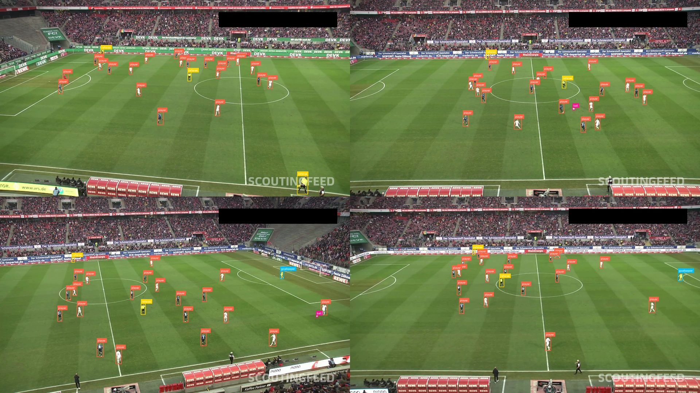
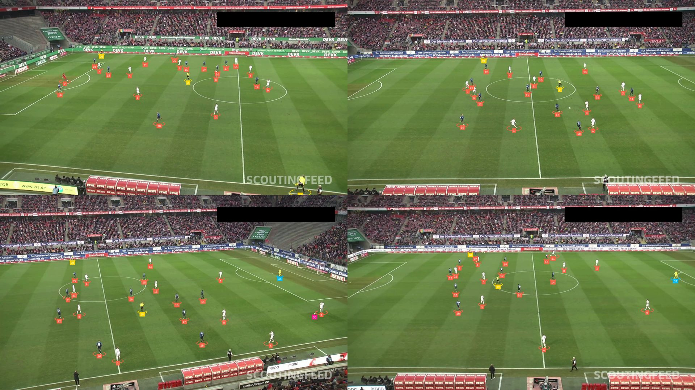
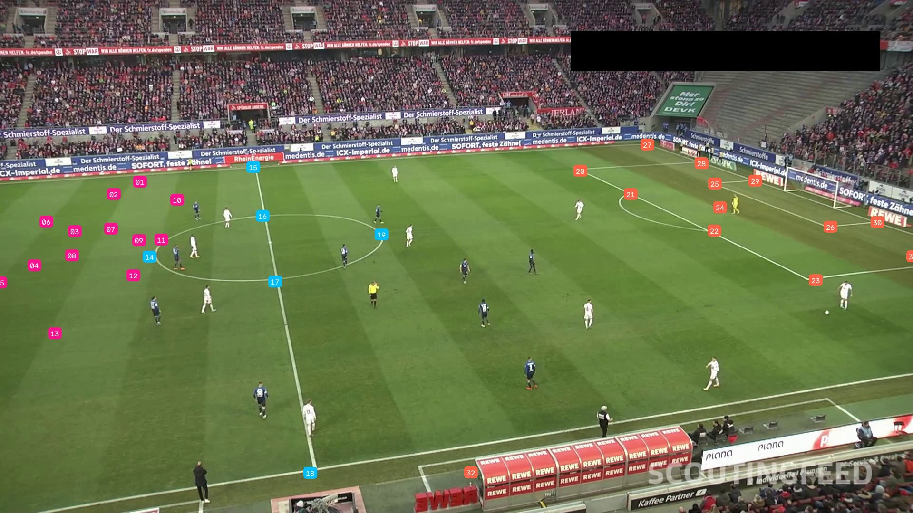
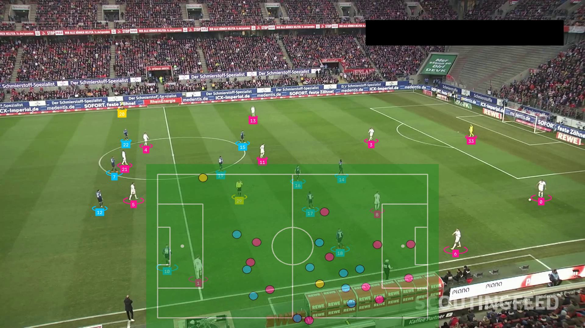

# Demo de `roboflow/sports` (tarea #5)

Ejecutada el 25 nov 2026 sobre `2e57b9_0.mp4` (Bundesliga, 30 s, 1920×1080, 25 fps, 750 fotogramas) con la GPU propia, usando los pesos ya entrenados de Roboflow. Las capturas son de los fotogramas 50, 250, 450 y 700 (2 s, 10 s, 18 s y 28 s).

Para que funcione con `supervision` 0.31 o posterior hay que aplicar [`tools/arreglar_bytetrack_roboflow.py`](../../tools/arreglar_bytetrack_roboflow.py).

## Detección (`PLAYER_DETECTION`)

- Detecta bien jugadores, porteros (cian), árbitros (amarillo) y el balón (rosa), incluidos los jugadores pequeños de la banda lejana.
- El balón no se detecta en todos los fotogramas: es pequeño y a veces está tapado.

## Tracking (`PLAYER_TRACKING`)

- Los IDs son estables en la mayoría de jugadores durante los 30 s (por ejemplo, el 11 y el 12 se mantienen en las cuatro capturas).
- Cuando un jugador entra en el encuadre recibe un ID nuevo (el portero aparece como 33 al final). En total se usan unos 33–36 IDs para unas 25 personas visibles: parte son entradas en el plano y parte cambios de ID.
- Los primeros fotogramas no tienen IDs: ByteTrack necesita 3 fotogramas seguidos para confirmar un track.

## Puntos del campo (`PITCH_DETECTION`)

- Los puntos visibles se detectan con precisión: línea central (15–18), círculo central (14, 16, 17, 19) y área derecha (20–30).
- **Problema importante:** el modelo devuelve siempre los 32 puntos, también los que no se ven. En la captura, los puntos 01–13 (área izquierda, fuera de plano) aparecen inventados sobre el césped, y el 32 junto al banquillo.
- La demo calcula la homografía con todos los puntos dentro de la imagen, **sin filtrar por confianza** (solo comprueba `x > 1` e `y > 1`). Esos puntos inventados entran en el cálculo.

## Radar (`RADAR`)

- Equipos bien separados (rosa: blancos; azul: oscuros; amarillo: árbitros).
- Las posiciones son coherentes en conjunto (jugadores a la izquierda y derecha del medio campo, árbitro cerca de la banda lejana), pero algunos jugadores cercanos a la cámara salen **sobre la línea de banda o fuera del campo**. Es compatible con el error de la homografía descrito arriba.
- Velocidad: unos **2,5 fotogramas por segundo** (unos 5 minutos para 30 s de vídeo). Casi todo el tiempo se va en recalcular el equipo de cada jugador con SigLIP en todos los fotogramas.

## Qué cambiamos en nuestra versión

| Problema observado | Solución | Tarea |
|---|---|---|
| Puntos del campo inventados entran en la homografía | Usar solo puntos con confianza > 0,5 y `cv2.findHomography` con RANSAC | #6 |
| Campo de 120 × 70 m por defecto | Configurar medidas reales (105 × 68 m) | #6 |
| Equipo recalculado en cada fotograma (lento) | Calcular el equipo una vez por `track_id` y guardarlo; ResNet-18 en lugar de SigLIP | #10 |
| Cambios de ID al entrar o cruzarse | Galería y re-identificación del jugador objetivo | #9 |
